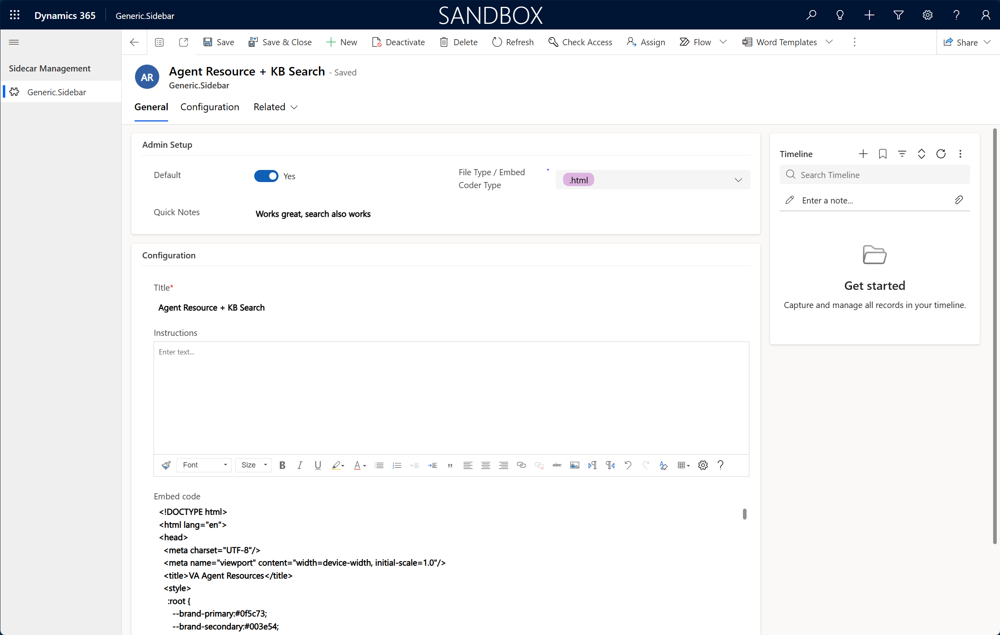
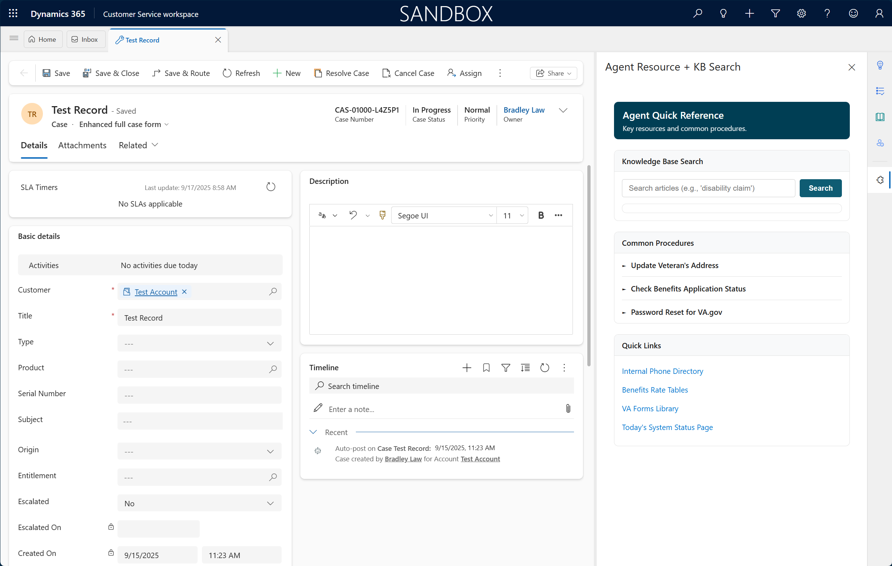
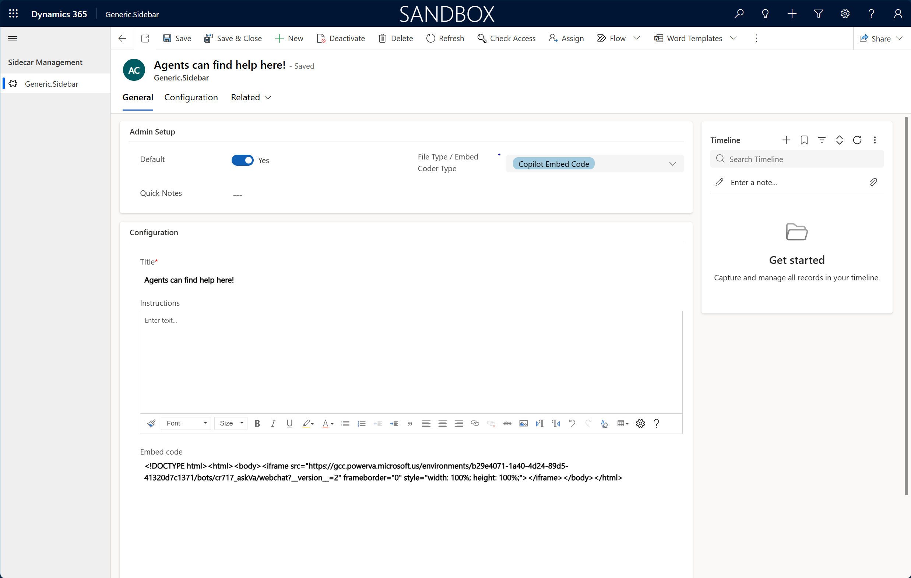
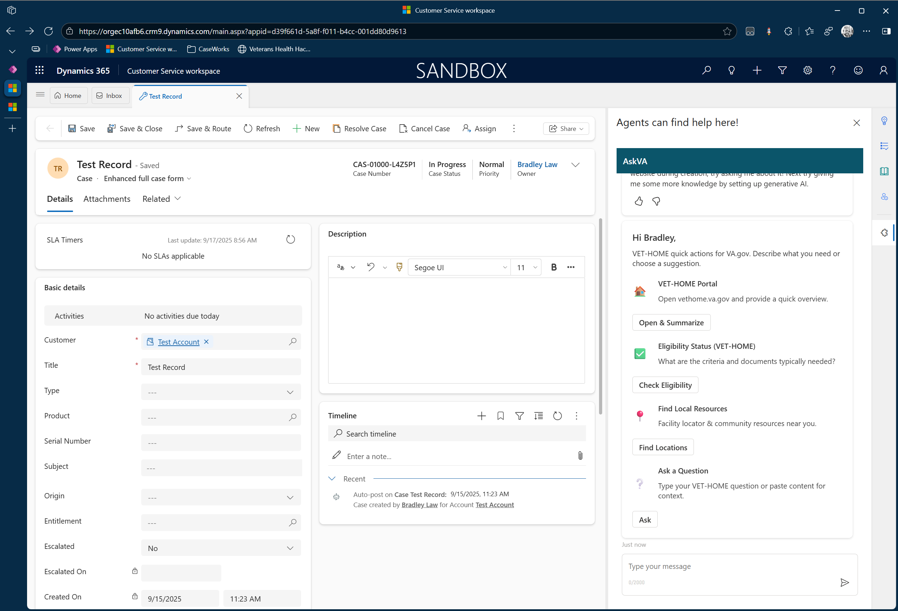

  

# Generic Sidebar for Dynamics 365

Generic Sidebar is a configuration-driven side pane for Dynamics 365 and other model-driven apps. Administrators define panel titles, instructions, embeds, dimensions, and theming in Dataverse instead of hardcoding a different sidebar for every form.

**Current Generic Sidebar Core release:** v1.0.0.11

## H004 integration candidate (not a release)

This branch reconciles Core alignment (#18), the H003 manifest (#22), H008
regressions (#23), and the narrow H007 fix (#24) on `main`. The local unmanaged
candidate is `GenericSidebar_1_0_0_12.zip`, with HTML 2.16.0 and JavaScript 2.7.0.
It is **not published, imported, or live-SSO certified**. The historical
1.0.0.5/1.0.0.7 ZIPs and published 1.0.0.11 asset are separate artifacts;
the H003 manifest remains historical evidence for #18, not this new candidate.

- Core remains independently installable: one through four panels, retained
  iframes, per-configuration selection, dimensions, zoom, and pop-out.
- Optional enterprise SSO and linked agents are separate deployment components.
  Their exact source-to-web-resource names are in
  [the enterprise inventory](config/enterprise-resources.json). Upload all six
  resources using those names and types, plus the optional schema, only in an
  authorized environment. `GenericSidebarEnterpriseResources_1_0_0.zip` delivers
  those exact resources, schema scripts and a hashed deployment inventory.
  It is **not a Dataverse solution ZIP**: do not import it as a solution.
- Do not enable SSO or select an Agent Menu Tab before the optional dependencies
  are installed. Missing configured dependencies display an error, not anonymous
  or bundled agents. SSO tokens use an expiring single-use in-memory handoff.
- Android, Genesys, ACS and GenericSoftphone stay external; none is a Core
  package dependency. The Power Apps SDK is an optional development dependency.
- The welcome acknowledgment is a **shared demo-only row flag**, subject to
  Dataverse write privileges, not admin-only or per-user production consent.
- Theme colors support validated hex, named colors and numeric RGB/HSL forms;
  unsupported values warn and retain the default theme.

See [the reconciliation and acceptance record](docs/CORE_RUNTIME_RECONCILIATION.md)
and [linked-agent setup](docs/agent-menu-tab-field-setup.md).

Local verification: `npm ci`, `npm test`, `npm run validate:runtime`,
`npm --prefix tests ci`, `npm run test:sso`, and
`pwsh -File scripts/verify-core-package.ps1`.
Build locally with `pwsh -File scripts/build-core-solution.ps1` (offline PAC
packaging; no login/import). Build the separate delivery bundle with
`pwsh -File scripts/build-enterprise-resources.ps1`.
H009 hosted Dynamics/Entra acceptance remains open.

## Current Repository Scope

This repository contains the core Generic Sidebar solution plus optional applications and demo assets that can be embedded in it. These are separate deployment units.

| Component | Current artifact | Relationship to Generic Sidebar |
| --- | --- | --- |
| **Generic Sidebar Core** | Release v1.0.0.11 | The installable Dynamics 365 solution. The checked-in `GenericSidebar_1_0_0_5.zip` archive is an older build retained in the repository. |
| **Android Cell Phone Simulator** | `Generic.AndroidCellPhone/AndroidCellPhone.html` 2.6.0 | Optional standalone application that can be embedded as sidebar content. It is not included in or required by the core solution. |
| **Genesys Softphone and examples** | Files under `SidecarItems/` | Optional demo integrations and content. They are not core solution prerequisites. |

The versions above identify separate artifacts. Updating an embeddable application does not change the core solution version.

## Generic Sidebar Core

The core solution uses the `sidebar_genericsidebar` Dataverse table to provide a shared sidebar configuration.

### Capabilities

- Up to four configurable panels.
- Rich-text instructions for each panel.
- Embeds from:
  - External URLs
  - HTML or iframe snippets
  - Power Apps canvas apps
  - Copilot Studio experiences
  - Dynamics web resources
- Optional panel icons and theming.
- Configurable iframe size, style, permissions, and referrer policy.
- Pop-out support for URL-based content.
- Shared default configuration selected through `sidebar_default`.

## Install the Core Solution

1. Obtain the Generic Sidebar Core v1.0.0.11 solution package.
2. Import the package into the target Dynamics 365 environment as a managed or unmanaged solution.
3. Open the **Generic Sidebar Configuration** table (`sidebar_genericsidebar`).
4. Create or select one configuration record and set `sidebar_default = Yes`.
5. Configure the first panel:
   - `sidebar_title1`
   - `sidebar_instructions`
   - `sidebar_embedcode`
6. Configure panels 2 through 4 with the corresponding numbered fields when needed.
7. Save the configuration and publish customizations.

An embed value can be an external URL, a `webresource:resource_name` reference, an iframe snippet, raw HTML, a Copilot Studio embed, or a Power Apps canvas app embed.

> The `GenericSidebar_1_0_0_5.zip` archive currently checked into this repository predates v1.0.0.11 and should not be presented as the current release package.

## Add Generic Sidebar to a Form

1. Add the `sidebar_sidebar.js` web resource as a form library.
2. Register `Generic_OpenSidebar` as an OnLoad handler and pass the execution context.
3. Save and publish the form.
4. Publish all customizations, then hard refresh the model-driven app.

The form opens the sidebar; the selected default Dataverse record controls its content.

## Embeddable Applications

### Android Cell Phone Simulator

The Samsung S25 Ultra phone simulator is a separate, self-contained HTML application intended for contact-center demonstrations. It can run standalone, as a Dynamics web resource, or inside a Generic Sidebar panel.

It is not part of the Generic Sidebar core package and is not required to use Generic Sidebar.

- [Android Cell Phone Simulator overview and embed instructions](./Generic.AndroidCellPhone/README.md)
- [Full phone simulator documentation](./Generic.AndroidCellPhone/DOCUMENTATION.md)
- [Phone application source](./Generic.AndroidCellPhone/AndroidCellPhone.html)

### Other Sidecar Content

The [`SidecarItems`](./SidecarItems) directory contains optional examples and integrations, including Copilot, journey, and softphone experiences. Treat each item as independently deployable content unless its own documentation says otherwise.

## Examples

### HTML configuration

### HTML displayed to an end user

### Copilot Studio configuration

### Copilot Studio displayed to an end user

## Validation and Reference Material

- [Acceptance tests](./TEST_ACCEPTANCE.md)
- [UX invariants](./UX_INVARIANTS.md)
- [System manifest](./SYSTEM_MANIFEST.json.md)
- [Binding certification](./BINDING_CERTIFICATION.md)
- [Solution specification](./SPEC.md)

## Known Limitations

- External sites can block iframe embedding through `X-Frame-Options` or Content Security Policy.
- The optional `sidebar_acknowledged` field controls the administrator disclaimer acknowledgement. Environments without that field skip the acknowledgement update.
- Embeddable applications can have their own data, security, browser, and deployment requirements.

## Disclaimer

This project is provided as-is and is intended primarily for demonstrations and proof-of-concept use. Validate security, accessibility, data access, browser policies, and solution behavior in a non-production environment before production deployment.

## License

See [LICENSE](./LICENSE).
