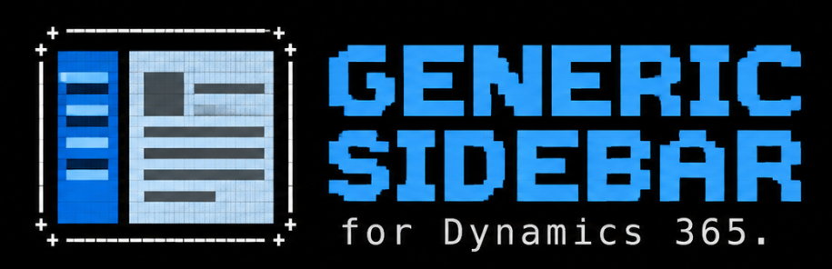
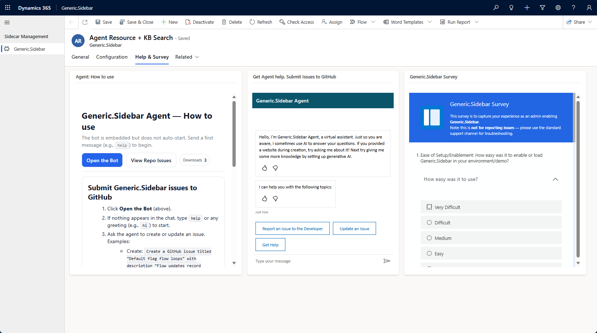

  

# Generic Sidebar for Dynamics 365 — Deployment Layer and Artifact Evidence
The Generic Sidebar kit provides a flexible, table-driven side pane for Dynamics 365 Customer Service and other model-driven apps.
Instead of writing custom HTML/JS each time, you configure a single Dataverse table row to control instructions, embeds, icons, and theming.

**Current published Core release (separate from the historical repository ZIP):** `GenericSidebar_1_0_0_11.zip` (solution `1.0.0.11`), release tag commit `fd1ac1fbb775443f6f9a5a2d6ea04aa5ddcad936`, GitHub asset SHA-256 `482cd5b5860b8858a6525616856225ff3c5bebb3263b5f79f577caa6d1a78942`. H003 records the release inventory and source drift; this is **not** a full package/source parity or live acceptance certificate. The checked-in `GenericSidebar_1_0_0_5.zip` is a historical archive, not the current release. H004's local unmanaged candidate `1.0.0.12` has not been published or approved for distribution.

## Repository navigation

The current `main` branch's overview and the evidence in this PR serve different purposes. Keep these existing entry points available while reconciling documentation; the files linked here are not deployment or certification approval.

- [Android Phone Simulator overview and embed instructions](./Generic.AndroidCellPhone/README.md)
- [Android simulator detailed behavior and prerequisites](./Generic.AndroidCellPhone/DOCUMENTATION.md)
- [Core acceptance criteria](./TEST_ACCEPTANCE.md), [system manifest](./SYSTEM_MANIFEST.json.md), and [binding certification](./BINDING_CERTIFICATION.md)
- [Core specification](./SPEC.md), [UX invariants](./UX_INVARIANTS.md), and [license](./LICENSE)

## Deployment Layers

This repository contains three separate deployment layers. They share integration contracts, not a single solution package or certification result.

| Layer | Artifact evidence (versions are not interchangeable) | Deployment boundary |
| --- | --- | --- |
| **Generic Sidebar Core** | Current published solution `1.0.0.11` is separate from the historical repository archive `1.0.0.5` (packaged HTML unmarked; packaged JS 2.3.0) and H004's unpublished local candidate `1.0.0.12`. The development source markers inspected with the historical archive were HTML 2.14.0 and JS 2.5.0. | Separately deployable Core-only solution: no Android, Genesys, GenericSoftphone, or `gensoft_*` add-in dependency. **Host-platform dependencies still apply**: the 1.0.0.5 ZIP's `solution.xml` references Microsoft Dynamics 365 Customer Service components, including components from `msdynce_Service`, `msdyn_ModernCaseManagement`, and `msdyn_CSIntelligence`. These are not packaged in Core and must be present as compatible prerequisites in the target environment. Packaged/source runtime parity remains blocked. |
| **Android Phone Simulator add-in** | `AndroidCellPhone.html` 2.6.0 | Optional demo add-in. Deploy standalone or as a separate web resource. Its optional Dataverse mode uses the separate GenericSoftphone schema. Never add it to the base Core package. |
| **Genesys Softphone Simulator add-in** | Current file has component header 1.0.0 and embedded UI marker 1.7.1; version identity remains unresolved | Optional demo add-in deployed separately. It can interoperate with Android 2.6.0 through `localStorage.genericSimCall`. Never add it to the base Core package. |

The historical SSO release label `v2.0.0`, specification versions, solution package version, and individual web-resource versions identify different artifacts. They are intentionally reported separately rather than being overwritten with one arbitrary version.

### Core capabilities and source-versus-package boundary

The Core configuration model supports rich panel instructions, URL/HTML/iframe, Power Apps and Copilot Studio content, optional theming, effective iframe dimensions, URL pop-out and a shared default row. The H004 **development** runtime supports one through four panels, including legacy two-panel compatibility. These are source-level descriptions, **not proof that the published 1.0.0.11 ZIP provides every feature**; inspect its own packaged runtime/schema and complete H009 acceptance before making a deployment claim.

### Historical Repository Package Verification (1.0.0.5 only)

On 2026-08-27, `GenericSidebar_1_0_0_5.zip` was inspected in memory without modification. The solution identifies itself as `GenericSidebar` 1.0.0.5 with publisher prefix `sidebar`. No archive entry name or textual payload contains Android, AndroidCellPhone, Genesys, Softphone, GenericSoftphone, or `gensoft_` content. The package must remain Core-only. The ZIP is authoritative for installed behavior; its single-content HTML renderer and 2.3.0 JavaScript differ from the multi-panel 2.14.0 HTML and 2.5.0 JavaScript development sources. Do not use source-only behavior to certify the installable package.

### Host-platform prerequisites (historical Core 1.0.0.5)

**Core-only does not mean dependency-free in every model-driven environment.** The embedded `solution.xml` declares required Microsoft first-party components, including dependencies associated with `msdynce_Service`, `msdyn_ModernCaseManagement`, and `msdyn_CSIntelligence`. These are host solution prerequisites, **not** Android/Genesys/GenericSoftphone add-ins and **not** components included in this Core ZIP. The examples are not a complete dependency inventory.

Before any separately authorized import, inspect the **exact ZIP's** `solution.xml` dependency entries and verify every required component and compatible host solution version in the designated target environment. A missing dependency can block solution import. No clean-environment import, host dependency reconciliation, or live certification is established by this documentation or the August 27 package inspection. The separate package/source runtime mismatch remains a release blocker.

### Historical v1.0.0.5 feature notes — not current release or production acceptance

✅ Admin Acknowledgement Banner
* Added a demo disclaimer banner. The welcome page itself does not enforce an administrator-only role check.
* Includes an “Acknowledge” button that updates `sidebar_acknowledged` on a shared default configuration row only if the caller has Dataverse write access; it does not record individual consent.
* Does not establish per-user consent, administrator identity or production authorization.

✅ PowerApps Canvas App support
* The sidebar_embedcode field now accepts Canvas App embed code alongside Copilot, URLs, HTML snippets, and web resources.

✅ Improved Copilot Embeds
* Full-height rendering ensured.
* Optional theming applied via sidebar_primarycolor, sidebar_textcolor, sidebar_linkcolor.

✅ Flow Template (Docs)
* Release notes & docs now include a recommended Power Automate Flow to enforce a single default row at any time.

🛠 Features
* Table-driven config (sidebar_genericsidebar) — no redeployments required.
* Rich instructions band with bullet/heading normalization.
* Embed options:
  * Copilot Studio Bot
  * External Websites
  * Raw HTML Snippets
  * PowerApps Canvas Apps

🪖 Optional
* Optional icon field (sidebar_sidebaricon) in header.
* Full iframe customization (allow, style, width, height).
* Safe defaults (auto-applied allow attributes, strict referrer policy).

---

## Optional Add-in: Android Phone Simulator

A self-contained Samsung S25 Ultra HTML phone simulator used for contact center demos. It is not part of Generic Sidebar Core and its deployment or validation does not certify Core.

**File:** `Generic.AndroidCellPhone/AndroidCellPhone.html` — **Version 2.6.0**
**Documentation:** `Generic.AndroidCellPhone/DOCUMENTATION.md`

### Features
* Samsung S25 Ultra chassis with realistic home screen, dock, status bar
* Outgoing + incoming call flows via `localStorage.genericSimCall`
* Dual mode: **D365 Mode** (Xrm.WebApi reads from Dataverse) / **Standalone Mode** (embedded fallback JSON)
* Settings screen (Ctrl+Shift+D or home grid icon) — profile selector, transcript toggle, browser URL config
* Standalone profile & transcript editing with localStorage persistence (D365 mode: read-only profiles)
* Embedded iframe browser (Chrome icon) with DuckDuckGo search, blocked-site detection, "Open in New Tab" fallback
* Web Audio API synthesized ringtone (440+480 Hz dual-tone, 2s on / 4s off cadence)
* Lock screen with swipe-to-unlock gesture, power button lock/unlock, real-time clock
* Camera screen with live webcam viewfinder (getUserMedia), shutter flash, front/rear flip, graceful fallback
* Fallback wallpaper, default Insurance Inquiry transcript

### Optional Add-in Dataverse Schema
* **Table 1:** `gensoft_genericsoftphone` — softphone configuration (ringtone, transcript, pop mode, wallpaper)
* **Table 2:** `gensoft_demo_profile` — pre-built demo profiles (queue/caller/scenario presets)
* **Solution:** GenericSoftphone v1.0.0.11 (Unmanaged)
* **Deployment script:** `specs/main/scripts/create-dataverse-schema.ps1`

These `gensoft_*` components belong to the optional add-in deployment. They are not prerequisites or members of `GenericSidebar_1_0_0_5.zip`.

## Optional Add-in: Genesys Softphone Simulator

The current Genesys simulator is stored at `SidecarItems/Genesys Softphone/Genesys Softphone.html` and is deployed separately from Generic Sidebar Core. Its D365 demo configuration uses the separate `gensoft_*` schema. It can also independently receive Android Phone Simulator events through `localStorage.genericSimCall`; Android 2.6.0 enters its own local in-call state after about three seconds, writes `RINGING` with `startTime: null`, and starts scripted demo transcript playback locally. That playback is not transcript capture and does not indicate a confirmed connection. Genesys manages its own ringing and answer flow and may change the shared call to `CONNECTED`; Android does not observe or wait for that change.

See [Genesys Softphone add-in documentation](SidecarItems/Genesys%20Softphone/README.md) for requirements, deployment, validation, and compatibility.

---

⚡ Usage Instructions
1. Check the exact Core ZIP's `solution.xml` prerequisites against the target environment's installed Microsoft host solutions and versions. Do not infer compatibility merely from the absence of optional simulator components.
2. Only after prerequisite validation and separate import authorization, import the applicable managed/unmanaged Core solution into the target Dynamics 365 environment.
3. Create a Config Row
   Open the Generic Sidebar Configuration table (sidebar_genericsidebar) and create one record with sidebar_default = Yes.
4. Set Key Fields
   Fill in:
   * `sidebar_title` — legacy/default pane-chrome title; retained as a fallback in H004's development JavaScript/HTML.
   * `sidebar_title1` — first panel title in the H004 1–4-panel development HTML, with `sidebar_title` as its compatibility fallback.
   * `sidebar_instructions` — first-panel rich-text instructions.
   * `sidebar_embedcode` — first-panel embed content; choose:

   https://... (External URL)
   <iframe ...></iframe> (Copilot or Canvas App)
   Raw HTML

Candidate-specific multi-panel field names above were checked against H004 `integration/h004-core-sso` source, not certified against published Core 1.0.0.11. Confirm the exact ZIP's table schema and packaged runtime before attempting an authorized import; the historical 1.0.0.5 archive and unpublished 1.0.0.12 candidate are not substitutes for that inspection.

Example of HTML Configuration

Example Displayed to End User

Example of Copilot Studio Configuration

Example Displayed to End User

Help, Issue Reporting and Survey\

How to Add JS to a new Form
1. Add the `sidebar_sidebar.js` web resource to your form and set OnLoad handler → `Generic_OpenSidebar` (passing the form execution context).
2. Publish & Refresh
3. Publish all customizations, then hard refresh (Ctrl/Cmd+Shift+R).

## GitHub Pages Publishing Boundary

The current workflow at `.github/workflows/static.yml` uploads `path: '.'`, so GitHub Pages publishes the entire checked-out repository rather than only the intended public site. This includes internal specifications, scripts, tests, archives, and certification documents.

The recommended future approach is to assemble a site-only `dist/` directory containing `index.html`, `downloads/`, approved `pages/` content, and only the public assets those pages require, then configure `actions/upload-pages-artifact` with `path: dist`. A direct site-directory artifact is also acceptable if the public files are consolidated first. This task does not change the workflow or deployment behavior; workflow scoping requires separate authorization and validation.

📋 Known Limitations
* External sites may block embedding (X-Frame-Options / CSP).
* sidebar_acknowledged is optional; banner skipped if missing.

⚠️ Disclaimer
This kit is provided as-is. It is intended primarily for demo / proof-of-concept purposes.
The shared welcome-banner acknowledgment is not an administrator-only gate or per-user consent record. Production use requires a separately approved security, governance and acceptance process.
